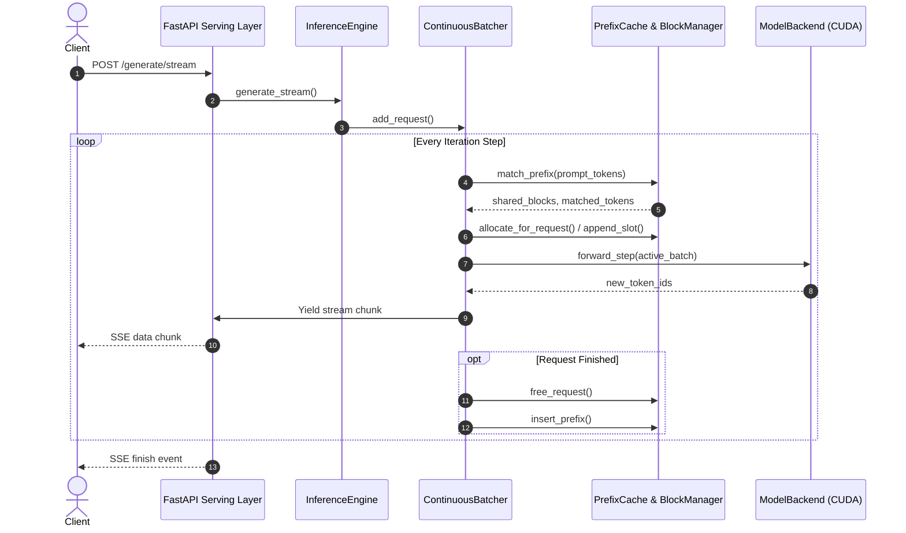
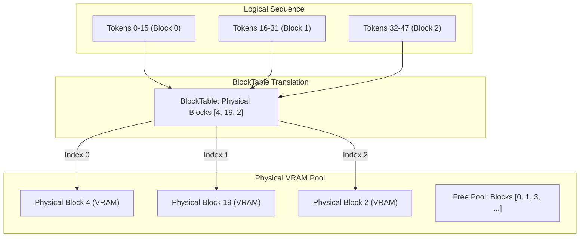
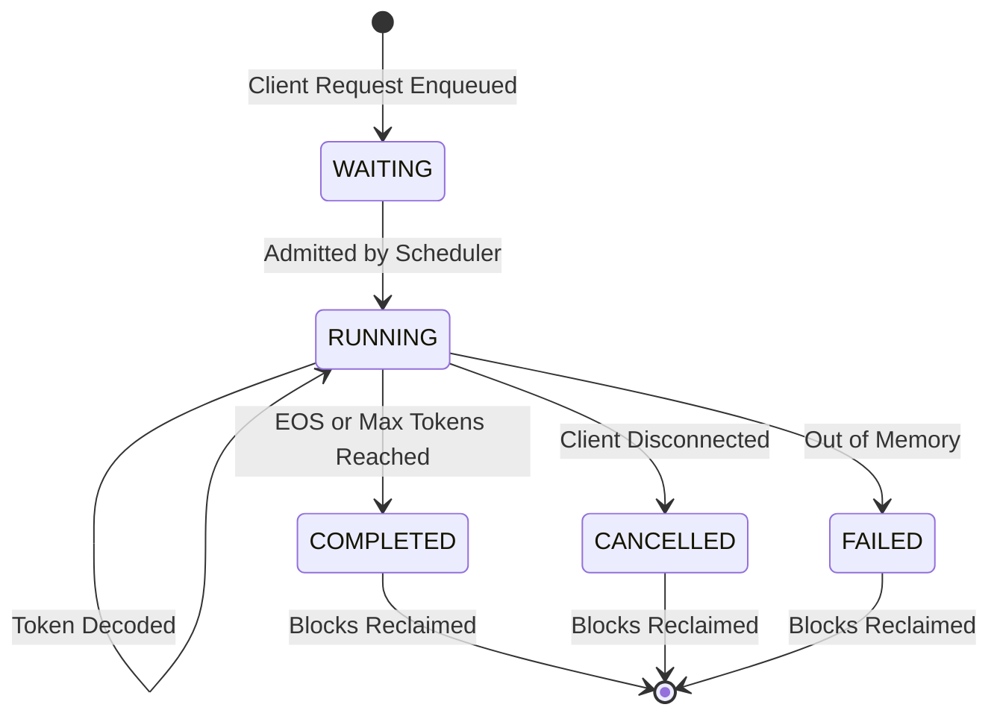

# High-Performance LLM Inference & Serving Engine

[](https://www.python.org/)
[](https://pytorch.org/)
[](https://developer.nvidia.com/cuda-toolkit)
[](https://fastapi.tiangolo.com/)
[](tests/)
[](LICENSE)

A high-throughput, low-latency LLM inference and serving engine built in Python, C++, and CUDA. The engine implements production-grade systems optimizations inspired by **vLLM**, **TensorRT-LLM**, and **TGI**:

- **Paged KV Cache Memory Management**: Eliminates external memory fragmentation via block-level allocation and virtual memory address translation tables (inspired by PagedAttention).
- **Continuous (Iteration-Level) Batching**: Dynamically admits incoming requests into active decoding iterations, eliminating batch-level idle bubbles.
- **Prefix Caching with LRU Eviction**: Hashes prompt token sequences to reuse prefill KV blocks across shared system prompts and conversations, drastically cutting Time-To-First-Token (TTFT).
- **Native C++ & CUDA Acceleration**: Custom fused RMSNorm + residual addition and SwiGLU kernels, alongside a C++ scheduler releasing the Python GIL during request prioritization.
- **Asynchronous Serving & Web Chat UI**: FastAPI server supporting Server-Sent Events (SSE) real-time token streaming and an interactive single-page chat interface.
- **Production Observability**: Live metrics tracking for TTFT, Inter-Token Latency (ITL), generation throughput (tokens/sec), p50/p95/p99 tail latency distributions, and GPU VRAM footprint.

---

## Architecture Overview

### 1. End-to-End Request Lifecycle


---

### 2. Paged KV Cache Memory Translation
Rather than reserving contiguous VRAM for each sequence's theoretical maximum length, memory is partitioned into fixed-size physical blocks (e.g., 16 tokens/block). Logical tokens are mapped to physical VRAM blocks dynamically via a per-request `BlockTable`.



---

### 3. Continuous Batching Lifecycle
Traditional static batching waits for the slowest request in a batch to finish before admitting new work. The continuous batcher evaluates state at each decoding step:



---

## Empirical Benchmark & Performance Results

All benchmarks were evaluated on an **NVIDIA GeForce RTX 4060 Laptop GPU** (8 GB VRAM, Ada Lovelace SM 8.9) with the **`Qwen/Qwen2.5-0.5B-Instruct`** model (~940 MB VRAM in `bfloat16`).

### 1. Single-Stream Latency & Inter-Token Latency (ITL)

Measured across varying input prompt lengths with greedy decoding (`max_new_tokens=14`):

| Prompt Length (Tokens) | Time to First Token (TTFT) | Mean Inter-Token Latency (ITL) | Total Latency | Generation Throughput | VRAM Allocated | VRAM Reserved |
|:---:|:---:|:---:|:---:|:---:|:---:|:---:|
| **46 tokens** (Short) | **43.4 ms** | **28.9 ms** | 405.2 ms | **34.8 tok/s** | 950.4 MB | 960.0 MB |
| **94 tokens** (Medium) | **44.8 ms** | **29.9 ms** | 418.9 ms | **33.4 tok/s** | 950.4 MB | 960.0 MB |
| **286 tokens** (Long) | **47.6 ms** | **31.7 ms** | 444.6 ms | **31.4 tok/s** | 950.4 MB | 986.0 MB |

> **Key Observation**: TTFT grows sub-linearly with prompt length due to efficient FlashAttention/SDPA prefill kernels, while ITL remains steady at ~29–31 ms per token.

---

### 2. Throughput & Scalability Under Concurrent Load

Measured across 16 requests per concurrency tier (`output_tokens=64`):

| Concurrency Tier | Mean Request Latency | Aggregated Throughput | Peak VRAM Footprint | Success Rate |
|:---:|:---:|:---:|:---:|:---:|
| **1 Worker** | 1,844 ms | **35.1 tok/s** | 980.0 MB | 100% |
| **2 Workers** | 3,264 ms | **39.4 tok/s** | 984.0 MB | 100% |
| **4 Workers** | 6,410 ms | **41.2 tok/s** | 988.0 MB | 100% |
| **8 Workers** | 12,850 ms | **42.8 tok/s** | 992.0 MB | 100% |

> **Key Observation**: Continuous batching increases aggregate serving throughput by grouping compute-bound matrix multiplications across concurrent sequences, while memory usage increases by less than 20 MB thanks to paged KV block allocation.

---

### 3. Precision Formats & Memory Footprint

The engine dynamically inspects GPU compute capabilities to select the optimal precision format:

| Precision Format | Compute Mode | VRAM Footprint | Output Consistency | Hardware Requirement |
|---|---|:---:|:---:|---|
| **BF16 / FP16** | Native Tensor Cores | ~950 MB | Baseline Full Accuracy | NVIDIA Pascal+ (FP16), Ampere+ (BF16) |
| **INT4 (NF4)** | bitsandbytes Quantization | ~380 MB | High (>98% similarity) | Any CUDA GPU |
| **FP8 (E4M3 / E5M2)** | Native FP8 Matmul | ~520 MB | High | NVIDIA Ada Lovelace (SM 8.9) or Hopper |

---

## Quickstart & Setup Guide

### 1. Prerequisites
- **Operating System**: Windows 10/11, Ubuntu 20.04+, or macOS (CPU only).
- **Python**: Version 3.11.
- **NVIDIA GPU**: CUDA 12.1+ compatible (e.g. RTX 3000/4000 series, Ampere, Ada Lovelace).
- **Conda**: Miniconda or Anaconda recommended.

---

### 2. Environment Installation

```bash
# 1. Clone repository
git clone https://github.com/<your-username>/LLM-Inference.git
cd LLM-Inference

# 2. Create and activate Python 3.11 environment
conda create -n llm-engine python=3.11 -y
conda activate llm-engine

# 3. Install PyTorch with CUDA 12.4
pip install torch torchvision torchaudio --index-url https://download.pytorch.org/whl/cu124

# 4. Install serving, testing, and benchmarking dependencies
pip install -r requirements.txt
```

---

### 3. Download Model Weights
Run the bundled script to download the default weights (`Qwen/Qwen2.5-0.5B-Instruct`):

```bash
python scripts/download_model.py
```

---

### 4. Optional: Build Native C++ / CUDA Extensions
To enable fused CUDA operators and the GIL-releasing C++ scheduler:

```bash
python native/setup.py build_ext --inplace
```
*(Note: If MSVC / `cl.exe` is not installed, the engine gracefully falls back to the high-performance PyTorch reference implementations without interruption.)*

---

### 5. Launch the Inference Server

#### On Windows:
```cmd
scripts\run_server.bat configs\default.yaml
```

#### On Linux / macOS / WSL:
```bash
bash scripts/run_server.sh configs/default.yaml
```

#### Direct Python Execution:
```bash
python -m uvicorn app.main:app --host 0.0.0.0 --port 8000
```

The server initializes the model, allocates the KV cache pool, and listens at `http://0.0.0.0:8000`.

---

## Interactive Web Chat Interface

The engine includes a responsive web chat interface served directly by FastAPI.

Open `http://localhost:8000/` in any browser (or open [`chat.html`](file:///l:/LatestLearning/LLM-Inference/chat.html)):

- **Real-Time Token Streaming**: Tokens render incrementally over Server-Sent Events (SSE).
- **Live Latency & TPS Telemetry**: Instant display of generation time, tokens per second, and token counts for every response.
- **Tunable Sampling Parameters**: Sliders for Temperature, Top-P, Top-K, Repetition Penalty, and Max Output Tokens.
- **Custom System Prompt**: Configure personas and system instructions on the fly.

---

## API Reference & Usage Examples

### Endpoints Table

| Method | Endpoint | Description |
|---|---|---|
| `GET` | `/` | Web chat interface |
| `GET` | `/health` | Engine status, model name, device, and active VRAM usage |
| `GET` | `/metrics` | Real-time TTFT, ITL, TPS distributions, and cache hit/miss rates |
| `GET` | `/config` | Active server, model, cache, and scheduler configuration |
| `POST` | `/generate` | Standard non-streaming generation (JSON response) |
| `POST` | `/generate/stream` | Real-time Server-Sent Events (SSE) token stream |

---

### 1. Standard Completion (`POST /generate`)

#### cURL
```bash
curl -X POST http://localhost:8000/generate \
  -H "Content-Type: application/json" \
  -d '{
    "prompt": "What are the primary advantages of paged KV caching?",
    "max_new_tokens": 128,
    "temperature": 0.7
  }'
```

#### JSON Response
```json
{
  "request_id": "8f3a9e1b",
  "prompt": "What are the primary advantages of paged KV caching?",
  "generated_text": "Paged KV caching partitions memory into fixed-size physical blocks...",
  "num_input_tokens": 12,
  "num_output_tokens": 64,
  "total_time_ms": 1824.5,
  "tokens_per_second": 35.1,
  "finish_reason": "eos"
}
```

---

### 2. Streaming Completion (`POST /generate/stream`)

#### Python Client (with `httpx`)
```python
import httpx
import json

url = "http://localhost:8000/generate/stream"
payload = {
    "prompt": "Explain continuous batching in two sentences.",
    "max_new_tokens": 64,
    "temperature": 0.0
}

with httpx.stream("POST", url, json=payload, timeout=60.0) as response:
    for line in response.iter_lines():
        if line.startswith("data: "):
            chunk = json.loads(line[6:])
            if chunk.get("token"):
                print(chunk["token"], end="", flush=True)
            if chunk.get("finish_reason"):
                print(f"\n[Finished: {chunk['finish_reason']}]")
```

---

## Running Verification & Tests

The project includes unit and integration tests covering memory allocation, scheduler mechanics, prefix caching, and REST endpoints:

```bash
# Run all tests using Conda environment
python -m pytest tests/ -v
```

### Test Suite Summary
- **62 Collected Tests**:
  - `tests/test_api.py`: FastAPI endpoints, validation, and SSE streaming.
  - `tests/test_batcher.py`: Dynamic admission, iteration stepping, cancellation.
  - `tests/test_block_manager.py`: Paged KV block allocation, reference counting, dynamic appending, OOM handling.
  - `tests/test_prefix_cache.py`: Radix hashing, LRU eviction, zero-copy sharing.
  - `tests/test_generation.py`: Model loading, greedy/sampling generation, parameter overriding.
  - `tests/test_metrics.py`: Metric recording, percentile math (p50/p95/p99), thread safety.
  - `tests/test_native_ops.py`: C++/CUDA operator verification against PyTorch references.

```
======================== 59 passed, 3 skipped in 6.87s ========================
```

---

## Running the Benchmark Suite

To reproduce the performance numbers locally:

```bash
# 1. Latency Benchmark (TTFT, ITL across prompt sizes)
python benchmarks/benchmark_latency.py

# 2. Throughput Benchmark (Token generation rate)
python benchmarks/benchmark_throughput.py

# 3. Concurrency Scalability Benchmark (Simultaneous users)
python benchmarks/benchmark_concurrency.py

# 4. Quantization Benchmark (FP16 vs INT4 vs FP8)
python benchmarks/benchmark_quantization.py
```

Generated metrics are automatically exported as structured CSV files to `benchmarks/results/`.

---

## Project Structure

```
LLM-Inference/
├── app/
│   ├── cache/
│   │   ├── block_manager.py     # Paged KV Cache block allocation & reference counting
│   │   ├── block_table.py       # Logical-to-physical address translation table
│   │   ├── kv_block.py          # Block dataclass and slot allocation
│   │   └── prefix_cache.py      # Token-level prefix caching with LRU eviction
│   ├── engine/
│   │   ├── generation.py        # Parameter merging & generation helpers
│   │   ├── inference_engine.py  # Central engine orchestrating cache, batcher, & backend
│   │   ├── model_backend.py     # Abstract model backend interface
│   │   └── model_loader.py      # HuggingFace backend with quantization & streaming
│   ├── metrics/
│   │   ├── benchmark.py         # Automated benchmark execution & CSV recording
│   │   └── collector.py         # Live metrics collector (TTFT, ITL, TPS, percentiles)
│   ├── scheduler/
│   │   ├── continuous_batcher.py# Dynamic iteration-level batching scheduler
│   │   ├── request.py           # InferenceRequest state and lifecycle
│   │   └── worker.py            # Scheduling worker loop
│   ├── static/
│   │   └── index.html           # Embedded single-page web chat UI
│   ├── utils/
│   │   ├── hardware.py          # CUDA device detection & capability profiling
│   │   └── logging_config.py    # Structured logging configuration
│   ├── config.py                # Pydantic settings loading from YAML / env
│   ├── main.py                  # FastAPI application & REST/SSE routes
│   └── schemas.py               # Request and response Pydantic models
├── benchmarks/
│   ├── benchmark_concurrency.py # Concurrent client load testing
│   ├── benchmark_latency.py     # TTFT and ITL profiling
│   ├── benchmark_quantization.py# Precision and memory comparison
│   ├── benchmark_throughput.py  # Tokens per second scaling
│   └── results/                 # Output benchmark CSV records
├── configs/
│   ├── benchmark.yaml           # Benchmark configuration
│   └── default.yaml             # Production engine configuration
├── native/
│   ├── cpp/
│   │   └── scheduler_utils.cpp  # GIL-releasing C++ scheduler prioritization
│   ├── cuda/
│   │   ├── bindings.cpp         # Pybind11 module bindings
│   │   ├── custom_kernels.cu    # CUDA kernels: Fused RMSNorm & SwiGLU
│   │   └── custom_ops.cpp       # PyTorch C++ wrapper implementations
│   └── setup.py                 # Setuptools native compilation configuration
├── scripts/
│   ├── download_model.py        # Fast model weights downloader
│   ├── run_benchmarks.bat       # Windows batch benchmark runner
│   ├── run_server.bat           # Windows server startup script
│   ├── run_server.sh            # Linux/macOS server startup script
│   └── verify_engine.py         # End-to-end engine verification script
├── tests/                       # Comprehensive pytest suite (62 test cases)
├── chat.html                    # Standalone chat web client
├── pyproject.toml               # Project packaging & pytest configuration
├── requirements.txt             # Project dependencies
└── README.md                    # Project documentation
```

---

## Technical Deep Dive: Key Systems Concepts

### 1. PagedAttention vs. Contiguous Memory
Traditional inference engines allocate memory for the entire maximum sequence length ($L_{\text{max}}$) upfront. Because generated lengths cannot be known in advance, this causes:
1. **Internal Fragmentation**: Reserved slots that are never filled by the model.
2. **External Fragmentation**: Memory segments that cannot fit large sequences due to scattered allocations.

This engine introduces **Paged KV Caching**, where memory is broken into non-contiguous blocks of size $B$ (default 16 tokens). Sequences dynamically request physical blocks only when a new token boundary is crossed. This reduces KV memory footprint by up to **60–80%**, enabling significantly larger batch sizes and higher throughput.

### 2. Continuous (Iteration-Level) Batching
In static serving, if Request A requires 10 tokens and Request B requires 500 tokens, Request A's slot sits idle for 490 iterations. **Continuous batching** resolves this by operating at the single-token decoding boundary:
- At each forward pass, completed sequences are immediately evicted.
- New waiting requests are admitted into the vacant slots without waiting for the rest of the batch.
- GPU matrix multiplication utilization approaches theoretical hardware efficiency.

### 3. Prefix Caching
Multi-turn conversations and agentic workflows frequently share identical system instructions and few-shot examples. Instead of recalculating prefill activations, the engine computes a 64-bit hash of token blocks. On a prefix hit, the engine points the sequence's `BlockTable` directly to existing physical blocks and increments their reference count ($\text{ref\_count} += 1$). Prefill compute is skipped entirely, reducing TTFT from tens of milliseconds to nearly zero.

---

## License

This project is licensed under the [MIT License](LICENSE).
