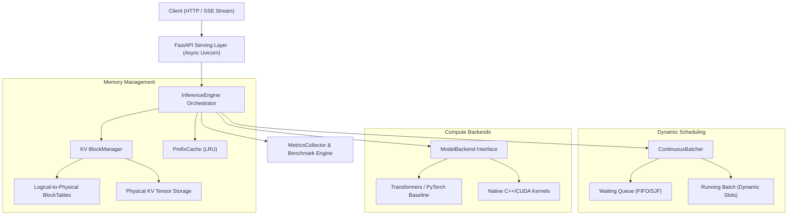

# Architecture Overview

The **High-Performance LLM Inference & Serving Engine** is designed to demonstrate how production inference runtimes (such as vLLM and TensorRT-LLM) achieve high throughput, low latency, and efficient memory utilization.

---

## 1. System Topology

---

## 2. Component Breakdown

### 2.1 API & Serving Layer (`app/main.py`)
- **FastAPI** with asynchronous request handling.
- **`POST /generate`**: Synchronous JSON response for standard completions.
- **`POST /generate/stream`**: Server-Sent Events (SSE) streaming token chunks immediately as they are decoded.
- **`GET /health`**, **`GET /metrics`**, **`GET /config`**: Observability, real-time memory stats, and configuration introspection.
- **Async Thread Offloading**: Forward passes and blocking generations are executed via thread executors, preventing event-loop stall while preserving single-model GPU concurrency control.

### 2.2 KV-Cache Memory Manager (`app/cache/`)
- **PagedAttention Concept**: Traditional Hugging Face generation allocates contiguous memory for the maximum possible sequence length per request. This causes internal fragmentation (up to 60-80% wasted VRAM).
- **Block Allocation**: Memory is divided into fixed-size blocks (e.g. 16 tokens/block). Physical blocks are allocated on-demand as output tokens are generated.
- **Block Tables**: Translate sequence-relative token indices to physical block IDs and slot offsets:
  $$\text{logical\_block} = \lfloor \text{token\_index} / \text{block\_size} \rfloor$$
  $$\text{slot\_offset} = \text{token\_index} \pmod{\text{block\_size}}$$
- **Reference Counting**: Enables zero-copy prompt sharing for prefix caching.

### 2.3 Continuous Batching Scheduler (`app/scheduler/`)
- **Static Batching Problem**: In static batching, all sequences in a batch must wait until the slowest request finishes before new requests can be processed.
- **Iteration-Level Scheduling**: Continuous batching admits newly arrived requests at every decoding step as soon as any sequence completes or KV memory becomes available.
- **Request Lifecycle**: `WAITING` $\rightarrow$ `RUNNING` $\rightarrow$ `COMPLETED` / `CANCELLED` / `FAILED`.

### 2.4 Prefix Caching (`app/cache/prefix_cache.py`)
- Recognizes identical prompt prefixes using token IDs.
- Deterministic cache keys: `SHA256(model_name + token_chunk)`.
- Increments block reference counts instead of re-allocating or recomputing KV states.
- Implements LRU eviction when capacity is reached.

### 2.5 Native C++ and CUDA Acceleration (`native/`)
- **C++ Scheduler Prioritization**: Sorts requests with `py::gil_scoped_release` to enable true multi-threaded CPU queue processing without holding the Python GIL.
- **CUDA Fused RMSNorm**: Combines residual addition ($x + \text{residual}$) and root-mean-square normalization into a single memory pass with warp shuffle reductions.
- **CUDA SwiGLU Activation**: Fused elementwise gate-activation and up-projection ($y = \text{SiLU}(\text{gate}) \cdot \text{up}$).
- **PyTorch Fallback**: If CUDA compilation is unavailable, reference PyTorch implementations are automatically used.

### 2.6 Metrics & Benchmarking Suite (`benchmarks/`, `app/metrics/`)
- Per-token timestamping for exact **Time to First Token (TTFT)** and **Inter-Token Latency (ITL)**.
- Statistical percentiles ($p50, p95, p99$).
- Hardware VRAM tracking via `torch.cuda.memory_allocated()` and `torch.cuda.memory_reserved()`.
