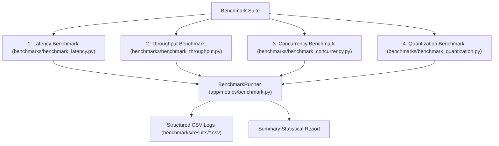

# Benchmarking & Performance Methodology

## 1. Metrics Definitions

| Metric | Definition | Importance |
|---|---|---|
| **Time to First Token (TTFT)** | Wall-clock time from request arrival to the emission of the first generated token. | Dictates user-perceived responsiveness and latency for interactive applications. Dominated by prompt prefill compute. |
| **Inter-Token Latency (ITL)** | Average time between consecutive generated tokens: $(T_{\text{finish}} - T_{\text{first\_token}}) / (N - 1)$. | Dictates reading speed. Must be $< 50\text{ms}$ for smooth, real-time human reading experience. Dominated by memory bandwidth. |
| **Tokens per Second (TPS)** | Output tokens generated per second for a single request: $N_{\text{out}} / T_{\text{gen}}$. | Per-user throughput. |
| **Aggregate Tokens per Second** | Total output tokens generated across all concurrent streams per second: $\sum N_{\text{out}} / T_{\text{wall}}$. | System-wide capacity and serving efficiency. Directly scales cloud hosting costs. |
| **Latency Percentiles ($p50, p95, p99$)** | 50th, 95th, and 99th percentile total request latencies across a workload distribution. | Measures tail latency under queueing and concurrency contention. |
| **KV Cache Allocation Efficiency** | Active cached tokens divided by total allocated capacity: $N_{\text{tokens}} / (N_{\text{blocks}} \times \text{BlockSize})$. | Measures internal memory fragmentation. Traditional systems suffer from $< 30\%$ efficiency; PagedAttention achieves $> 90\%$. |

---

## 2. Benchmark Suite Architecture

---

## 3. Methodological Rules for Credible Benchmarks

To ensure accurate systems evaluation without fabricated or misleading numbers:
1. **Model Pre-Warming**:
   - Always run 2-3 warm-up forward passes prior to measurement.
   - Prevents CUDA kernel JIT compilation, PyTorch CUDA memory allocator initialization, and weights caching from skewing the first measurement.
2. **Actual Token Counting**:
   - Never count whitespace-separated words as tokens.
   - Use the tokenizer's exact token length via `len(tokenizer.encode(text))`.
3. **Exact Timing Isolation**:
   - Distinguish network queueing delay from GPU forward-pass execution time.
   - Measure wall-clock duration with high-resolution `time.perf_counter()`.
4. **Honest Precision Reporting**:
   - Never report FP8 or INT4 unless the backend actually loaded the model in that precision mode. If hardware fallback to FP16/BF16 occurred, explicitly report the fallback.
