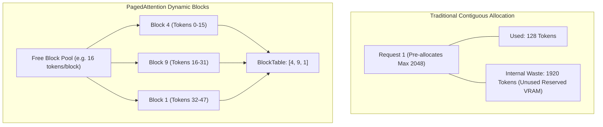

# KV Cache & PagedAttention Design

## 1. The Memory Bottleneck in LLM Serving

In autoregressive generation, each token generated attends to all previous tokens (Query $\times$ Key, followed by Softmax $\times$ Value).
To avoid recalculating Key and Value vectors for all past tokens at every step, past Keys and Values are stored in the **KV Cache**.

### Memory Calculation:
For a model with:
- $L$ layers
- $H_{kv}$ key-value heads
- $D$ head dimension
- Precision: 2 bytes (FP16/BF16)

The KV cache memory required per token is:
$$\text{Memory per token} = 2 \times L \times H_{kv} \times D \times 2 \text{ bytes}$$

For **Qwen2.5-0.5B** ($L=24$, $H_{kv}=2$, $D=64$):
$$\text{Memory per token} = 2 \times 24 \times 2 \times 64 \times 2 = 12,288 \text{ bytes} \approx 12 \text{ KB/token}$$

For a sequence of 2,048 tokens:
$$2048 \times 12 \text{ KB} \approx 24.5 \text{ MB per request}$$

While small for 0.5B, for a 70B model ($L=80, H_{kv}=8, D=128$), it requires **327 KB/token**, or **670 MB per sequence**!

---

## 2. PagedAttention vs Contiguous Allocation

### Key Differences:
1. **Contiguous Allocation**:
   - Must reserve memory for `max_seq_len` upfront because tensors must be contiguous in memory.
   - Causes **internal fragmentation** (reserved memory never written to).
   - Prevents memory sharing across requests.

2. **PagedAttention**:
   - Divides the physical KV cache into fixed-size blocks (e.g. 16 tokens).
   - Blocks do not need to be contiguous in physical VRAM.
   - Allocated dynamically as tokens are generated.
   - Waste is bounded to at most $15 \text{ tokens}$ per active request (the partial last block).

---

## 3. Logical to Physical Address Translation

When token $t$ is accessed:
1. **Logical Block Index**: $\text{logical\_idx} = \lfloor t / \text{block\_size} \rfloor$
2. **Block Offset**: $\text{offset} = t \pmod{\text{block\_size}}$
3. **Physical Block ID**: $\text{phys\_id} = \text{block\_table}[\text{logical\_idx}]$
4. **Physical Memory Pointer**:
   $$\text{Storage}[phys\_id, layer, head, offset, :]$$

---

## 4. Reference Counting for Prefix Sharing

When Request B has the same prompt prefix as Request A:
- Instead of allocating new blocks and recomputing Key/Value tensors:
  $$\text{BlockTable}_B[0] = \text{BlockTable}_A[0]$$
  $$\text{Block}_0.\text{ref\_count} \mathrel{+}= 1$$
- When Request A finishes:
  $$\text{Block}_0.\text{ref\_count} \mathrel{-}= 1$$
- Because $\text{ref\_count} > 0$, the block is **not freed** back to the free pool until Request B also completes.
