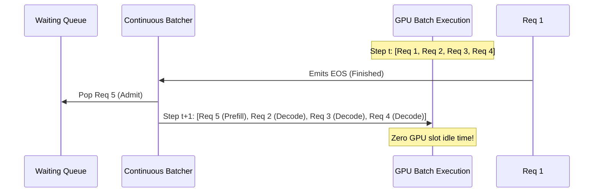

# Continuous Batching & Scheduling

## 1. Static vs Continuous Batching

In traditional LLM serving systems, incoming requests are grouped into a static batch (e.g. batch size = 4).
Because language models generate text autoregressively (one token at a time), sequence lengths vary wildly:

```
Request 1: [Prompt: 32 tokens] -> Generates 15 tokens  (Finishes early)
Request 2: [Prompt: 32 tokens] -> Generates 512 tokens (Long generation)
Request 3: [Prompt: 32 tokens] -> Generates 40 tokens  (Finishes early)
Request 4: [Prompt: 32 tokens] -> Generates 200 tokens
```

### The Problem with Static Batching:
- Requests 1 and 3 finish in just a few iterations, but their GPU slots **sit completely idle** while Request 2 finishes its 512 tokens.
- New waiting requests cannot be admitted until the entire batch finishes.
- Hardware compute cores and memory bandwidth are wasted on padding.

### Continuous (Iteration-Level) Batching:
Instead of scheduling batches at the request level, scheduling decisions are made at **every token iteration**:
1. At iteration $t$, Request 1 emits an EOS (End of Sequence) token and finishes.
2. The scheduler immediately evicts Request 1 and reclaims its KV cache blocks.
3. On iteration $t+1$, Request 5 from the waiting queue is **immediately admitted** into the active batch!
4. The GPU executes prefill for Request 5 alongside decode steps for Requests 2, 3, and 4.



---

## 2. Dynamic Memory Admission Control

A naive continuous batcher might admit requests until the batch size reaches a maximum limit (e.g. 16).
However, if the KV cache runs out of physical memory during decoding, requests would crash with CUDA OOM!

The `ContinuousBatcher` implements **proactive admission control**:
1. Before admitting candidate request $R$, it checks:
   $$\text{FreeBlocks} \ge \left\lceil \frac{\text{PromptTokens}(R) - \text{PrefixSharedTokens}}{\text{BlockSize}} \right\rceil$$
2. If available memory is insufficient, admission is deferred until active requests complete.
3. If an unforeseen OOM occurs during decoding, the affected request is gracefully failed without crashing the engine or affecting other concurrently running requests.
